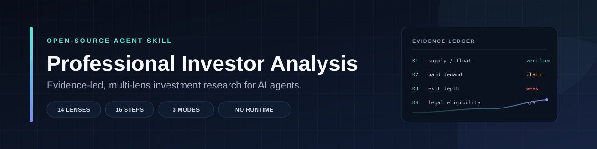
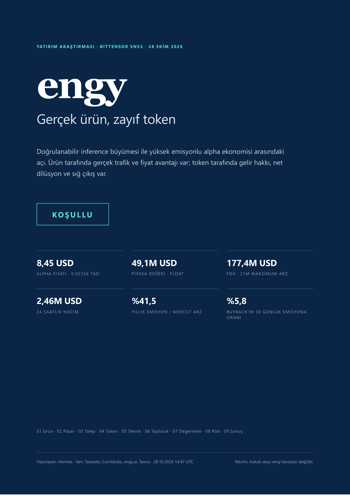

# Professional Investor Analysis

**Evidence-led, multi-lens investment research for AI agents.**

[](https://github.com/Elfonius/professional-investor-analysis/actions/workflows/validate.yml)
[](LICENSE)
[](CHANGELOG.md)
[](#installation)

Most AI investment prompts produce a confident narrative from a handful of numbers. This skill does the opposite: it forces a **decision frame**, an **evidence ledger**, a **non-compensatory investability gate**, and a report that separates **project quality** from **instrument attractiveness**, **price**, **timing** and **personal suitability**.

It is built for crypto first — tokens, protocols, subnets and DeFi — and covers equities, credit, funds, private companies, real assets, commodities and derivatives.

```
14 lenses · 16 steps · 3 delivery modes · 11 references · 4 English templates
No runtime · No API keys · No vendor lock-in
```

---

## Why this exists

A good investment memo is not a long description of a project. It is an argument with evidence, a valuation, a counter-thesis and a condition under which the author would be wrong.

This skill encodes that discipline for an AI agent:

- **Evidence before narrative.** Every material claim records its type, value, unit, date, source, independence and status.
- **A gate that cannot be bought off.** A growth story, a high score or a bullish chart cannot compensate for a broken claim chain, an unenforceable right or an exit that does not exist.
- **Separate questions, separate answers.** Is the *project* good? Is the *instrument* good? Is the *price* good? Is *now* good? Is it *suitable* for this investor? The skill refuses to collapse them into one score.
- **Progressive disclosure.** The core `skill/SKILL.md` is about 4,054 tokens. The 11 references load only when their lens is material, so the agent does not carry the whole methodology on every turn.
- **Outputs that fit the decision.** A one-page screen for a first look, a 3–5 page memo for a working decision, or an 8–15 page PDF plus a one-page IC summary and an evidence workpaper for a committee.
- **Portable by design.** Plain Markdown. Works in Hermes, Claude Code, Codex, Cursor or any agent that can read instruction files.

---

## Quick start

### Hermes Agent

```bash
git clone https://github.com/Elfonius/professional-investor-analysis.git

# macOS / Linux
mkdir -p ~/.hermes/skills/research/professional-investor-analysis
cp -R professional-investor-analysis/skill/. ~/.hermes/skills/research/professional-investor-analysis/
```

```powershell
# Windows PowerShell
git clone https://github.com/Elfonius/professional-investor-analysis.git
New-Item -ItemType Directory -Force "$env:LOCALAPPDATA\hermes\skills\research\professional-investor-analysis" | Out-Null
Copy-Item -Recurse "professional-investor-analysis\skill\*" "$env:LOCALAPPDATA\hermes\skills\research\professional-investor-analysis\"
```

Reload skills or restart Hermes. The skill appears as `professional-investor-analysis`.

### Claude Code

```bash
mkdir -p .claude/skills/professional-investor-analysis
cp -R professional-investor-analysis/skill/. .claude/skills/professional-investor-analysis/
```

### Other agents

Copy the contents of `skill/` (`SKILL.md`, `references/` and `templates/`) next to your agent's instructions, or paste `SKILL.md` into its system prompt and keep the references available for on-demand loading. See **[docs/INSTALL.md](docs/INSTALL.md)** for a generic loader prompt.

Prefer a skill-only download? Use the [latest release](https://github.com/Elfonius/professional-investor-analysis/releases/latest) and unzip it into your skills directory.

### First prompt

```text
Use professional-investor-analysis. Evaluate <asset> for a 12-month horizon in USD.
Start with the investability gate, then produce a standard memo.
Mark every lens you cannot assess as "not assessable" and name the missing input.
```

---

## How it works

The workflow has four stages and 16 steps. Every stage produces an artifact the next stage can audit.

**Frame → Analyze → Test → Decide**

| Stage | Steps | What it produces |
|---|---|---|
| **Frame** | 1–4: decision frame · asset and claims map · evidence ledger · freshness | A question worth answering and a ledger that can be checked |
| **Analyze** | 5–10: business · market · demand and unit economics · team · instrument · ownership and flows | The business case and the instrument case, kept separate |
| **Test** | 11–15: technical · community and news · legal and security · valuation · stress test | Price, timing, legal and downside tests |
| **Decide** | 16: verdict · monitoring · report | A conditional decision and the evidence behind it |

### The 14 lenses

| # | Lens | Core question |
|---|---|---|
| 1 | Decision and suitability | What decision, horizon, benchmark, constraints and biases frame the analysis? |
| 2 | Asset and instrument | What exactly is owned, and what rights does it carry? |
| 3 | Market and competition | Market structure, peers, share, pricing power, cycle/macro transmission |
| 4 | Business and product | Real usage, pricing, distribution, cost structure, moat |
| 5 | Demand and revenue quality | Paid versus incentivized, external versus in-group, concentration, retention |
| 6 | Unit economics | Revenue/unit, cost/unit, gross margin, CAC/payback, funding source |
| 7 | Team and organization | Founders, critical roles, verified track record, funding, key-person |
| 8 | Instrument and token economics | Rights ladder, supply, float/FDV, emissions, unlocks, value capture |
| 9 | Ownership and on-chain flows | Holders, staking, protocol buys, root sales, treasury, validator/miner concentration |
| 10 | Technical and market structure | Trend, relative strength, volatility, drawdown, depth, slippage, derivatives |
| 11 | Community, news and catalysts | Social, GitHub, governance, news flow, sentiment, catalyst calendar |
| 12 | Legal, regulation and security | Jurisdiction, classification, KYC/AML, audit, key control, incidents |
| 13 | Valuation | DCF, multiples, reverse valuation, revenue-to-token bridge, scenarios, expected return |
| 14 | Risk and portfolio fit | Risk matrix, stress test, pre-mortem, correlation, liquidity, macro, ESG, behavioral bias |

Every lens must be **covered with evidence** or **explicitly excluded** as `not material` or `not assessable` with a reason. A silent omission is a defect.

### Delivery modes

| Mode | Output | Use when |
|---|---|---|
| **Screen** | 1 page, 300–500 words | First look, comparison, triage |
| **Standard** | 3–5 page memo | A working decision with moderate evidence |
| **Deep** | 8–15 page PDF + 1-page IC summary + workpaper | Buy/size/hold/exit, committee review, or "cover every perspective" |

Deep mode does not drop the uncomfortable parts to fit a page. The one-page executive summary is mandatory; the evidence lives in the workpaper.

---

## What is inside

```text
.
├── skill/                       # the installable skill package
│   ├── SKILL.md                 # the method: 16 steps, 14 lenses, gates, modes
│   ├── references/              # load only when the matching lens is material
│   │   ├── methodology-and-sources.md
│   │   ├── crypto-diligence.md
│   │   ├── crypto-legal-security.md
│   │   ├── crypto-market-intelligence.md
│   │   ├── crypto-onchain-flows.md
│   │   ├── crypto-technical.md
│   │   ├── crypto-unit-economics.md
│   │   ├── crypto-valuation.md
│   │   ├── team-and-org.md
│   │   ├── portfolio-fit.md
│   │   └── pdf-report-production.md
│   └── templates/
│       ├── investment-screen-en.md
│       ├── investment-memo-en.md
│       ├── investment-report-en.md
│       ├── investment-committee-en.md
│       ├── investment-analysis.md   # evidence workpaper
│       └── *-tr.md                  # Turkish equivalents
├── examples/                    # fictional screens + a real deep-report PDF
├── docs/                        # install, usage, methodology, architecture, FAQ
├── scripts/validate.py          # structural validator + optional token count
└── .github/workflows/validate.yml
```

### Start here

| If you want to… | Read |
|---|---|
| Install in your agent | [docs/INSTALL.md](docs/INSTALL.md) |
| Run a screen, memo or deep report | [docs/USAGE.md](docs/USAGE.md) |
| Understand the method | [docs/METHODOLOGY.md](docs/METHODOLOGY.md) |
| See the file and token architecture | [docs/ARCHITECTURE.md](docs/ARCHITECTURE.md) |
| Check common objections | [docs/FAQ.md](docs/FAQ.md) |
| See output | [examples/](examples/) |

---

## Quality

The repository is validated on every push and pull request:

```bash
python scripts/validate.py . --strict
```

The validator checks frontmatter, name and description limits, body size, token ceiling (when `tiktoken` is installed), reference pointers, placeholder leakage, table consistency and relative links.

Current core skill:

| Check | Result |
|---|---|
| `skill/SKILL.md` | 128 lines |
| Tokens (o200k_base) | 4,054 |
| Ceiling | 5,000 |
| References | 11 |
| Templates | 8 content templates + index (4 English, 3 Turkish, 1 workpaper) |
| Runtime dependencies | none |
| Package validator | `python scripts/validate.py . --strict` — PASS |

Structural quality is not predictive validity. The skill makes the analysis more disciplined and auditable; it does not guarantee returns, and it is not a substitute for licensed advice or primary documents.

---

## Example output

A real deep-report output produced with this skill (Turkish, 14 pages, 6 charts, data as of 2026-10-28). It is included as a **design and structure example**, not a current recommendation.

[](examples/engy-sn53-deep-report-tr.pdf)

[Open the 14-page PDF](examples/engy-sn53-deep-report-tr.pdf)

The report includes a cover, a one-page executive summary, a 10-dimension scorecard, product/market/demand/unit-economics/token/on-chain/technical/community/legal/valuation/risk sections, a scenario table, a risk matrix and a monitoring dashboard.

---

## Design principles

1. **No composite score.** A single number hides the trade-offs that matter. Report the dimensions; state the verdict conditionally.
2. **No silent omission.** If a lens is not material, say so. If it cannot be assessed, say what input is missing.
3. **No fake precision.** Use ranges and scenarios; label assumptions; do not present a point estimate as a fact.
4. **No position sizing without constraints.** The skill can assess suitability only when the user supplies horizon, drawdown, liquidity, currency and jurisdiction.
5. **No claim without a date.** Markets, emissions, holders and legal positions change. Every number carries an as-of date.
6. **No promotional language.** "Partnered with", "audited", "real yield" and "buyback" are claims to test, not facts to repeat.

---

## Customize it

- **Add an asset class:** add a row to the asset-class table in `skill/references/methodology-and-sources.md`, a valuation approach in `skill/references/crypto-valuation.md` (or a new reference), and a template section.
- **Add a lens:** add it to the 14-lens table, the workpaper matrix and the report scorecard. Do not add it only to the prose.
- **Change house style:** edit the templates in `skill/templates/`, not `skill/SKILL.md`. The method should stay stable while the output format changes.
- **Localize:** the English and Turkish templates show the pattern. Keep the evidence tags and the gate vocabulary intact across languages.

See [CONTRIBUTING.md](CONTRIBUTING.md) for the evidence standard and PR checklist.

---

## Limitations

This is a research method, not a licensed investment adviser, broker, legal adviser, tax adviser or auditor. It does not verify private information, guarantee data access, or replace primary documents. A report can be well-structured and still wrong. Use current sources, independent verification and, where material, a qualified professional.

Nothing in this repository is investment advice or a recommendation to buy or sell any asset.

---

## Contributing

Issues and pull requests are welcome. Please read [CONTRIBUTING.md](CONTRIBUTING.md) and [CODE_OF_CONDUCT.md](CODE_OF_CONDUCT.md) first.

- Bug or broken pointer: use the bug report template.
- New lens, asset class or template: use the feature request template and include the evidence standard you will apply.
- Security issue: follow [SECURITY.md](SECURITY.md); do not open a public issue with sensitive details.

## License

MIT — see [LICENSE](LICENSE).

## Citation

If you use this skill in research or a product, cite it via [CITATION.cff](CITATION.cff). Attribution is appreciated; the MIT license does not require it.

## Acknowledgements

Built with Hermes Agent. Designed around publicly documented investment-diligence practice, including CFA Institute ethics and professional-standards material, SEC investor-education guidance, and open-source agent-skill conventions. No affiliation or endorsement is implied.

---

**If this saves you from one bad memo, it did its job.**
